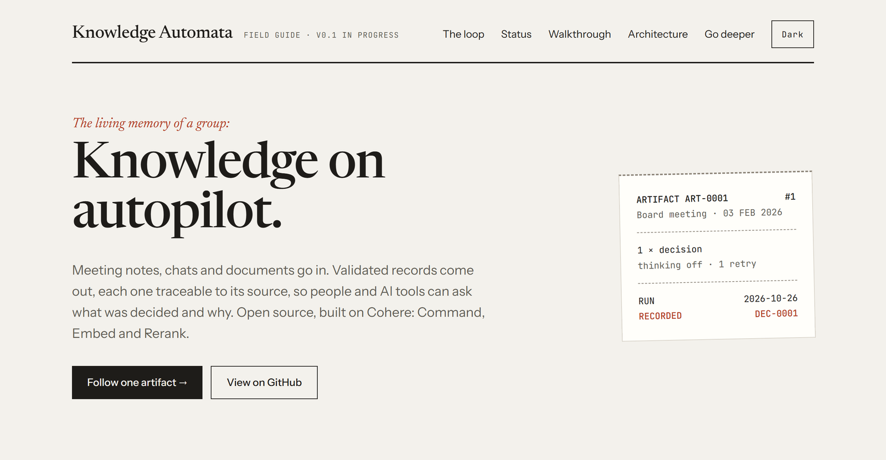
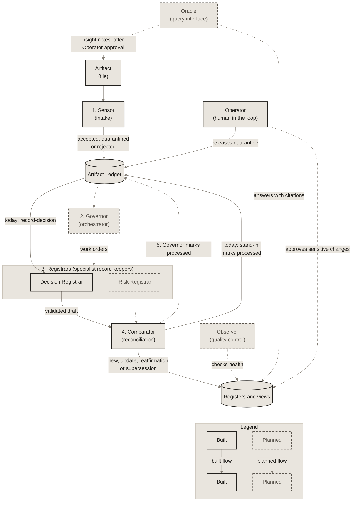

# Knowledge Automata

*Knowledge on autopilot.*
*The living memory of any group that makes decisions together.*

<a href="https://miguelmog10.github.io/knowledge-automata/guide/">
  <picture>
    <source media="(prefers-color-scheme: dark)" srcset="docs/guide/preview-dark.png">
    
  </picture>
</a>

**[Open the visual guide →](https://miguelmog10.github.io/knowledge-automata/guide/)** The closed loop, the status at a glance, and a click-through of one real run.

[](https://github.com/miguelmog10/knowledge-automata/actions/workflows/ci.yml)

## What it is

Knowledge Automata is a general-purpose institutional memory for any group that makes decisions together: a project team, a company department, a research group, a neighborhood association. A multi-agent LLM system turns messy artifacts (meeting notes, chats, documents) into validated, structured records, each traceable to the artifacts it came from, so people and AI tools can ask what the group knows and why. v0.1 targets project teams with PMI-aligned registers: a decision log and a risk register. It is open source (Apache 2.0) and built on Cohere's platform (Command, Embed, Rerank) behind a provider-agnostic service layer.

**See it working:** [a real decision record](examples/sample-project/views/decision-log/DEC-0001.md) that Command drafted from [fictional meeting notes](examples/sample-project/artifacts/ART-0001-project-board-2026-02-03.md), with every quote checked against the source and committed unedited.

## Status

v0.1 in progress. Works today:

- An LLM service layer on Cohere's SDK: Command, Embed and Rerank behind provider-neutral interfaces, with a metadata-only log of billed units, latency and request IDs.
- The first end-to-end slice: one artifact goes through the Decision Registrar (specialist record keeper) on real Command calls and becomes one validated decision record, with generated Markdown views.
- The Sensor (intake and input guardrail) and the Artifact Ledger: deterministic intake checks, duplicates found by content hash, suspicious files quarantined for the Operator (human in the loop), and one Ledger entry per artifact that lists the records it produced.
- The Comparator (reconciliation): each new decision is compared with the existing ones (Embed, then Rerank, then Command) and recorded as new, a reaffirmation, an update or a supersession. Code checks the classification and applies the write rule, so a decision restated in a later meeting adds sources to its record instead of becoming a duplicate.

Next: the Governor (orchestrator), the Risk Registrar and an evaluation set. Details in [dev/STATUS.md](dev/STATUS.md).

## Why

Knowledge is created constantly and lost just as fast. Decisions sit in meeting notes, chats and documents, so groups rediscover context and re-argue settled decisions over and over.

Even a perfect memory would still need a record. A record is shared truth that everyone can see and agree on. It makes ownership of decisions clear, keeps the history of how and why they changed, outlives any single tool, chat or model, and is what governance and audits rely on. Knowledge Automata keeps that record, so people and AI tools can answer from it.

Project management is the first application. Formal registers such as a decision log and a risk register solve this, but they are expensive to maintain by hand, which is why Agile teams often skip them. Knowledge Automata maintains them automatically as a side effect of normal work, so teams get PMI-quality records without the overhead.

## Design principles

- **The model proposes, code checks.** The LLM is used only where judgment is needed. Code assigns IDs, checks every evidence quote word for word against the source artifact, validates each record against its JSON Schema and stores it. An invalid draft gets one retry with its errors; if the retry fails, the record is rejected and nothing is written ([ADR-0014](docs/decisions/0014-registrar-drafting-loop.md)).
- **Measured, not assumed.** Every model call logs its billed units, latency and request ID ([ADR-0012](docs/decisions/0012-llm-service-layer-observation-and-cost.md)). Choices follow the numbers: the smoke check suggested thinking disabled would save output tokens, but the first real reconciliation run showed Command A+ then writes its reasoning as prose before the JSON, so most first replies were rejected; thinking is now enabled ([ADR-0014](docs/decisions/0014-registrar-drafting-loop.md)).
- **Engineered like a product, scaled to a prototype.** More than 700 tests run offline with the network blocked. CI runs on Python 3.11 and 3.15 with a dependency audit and checks that the committed views match the records. Significant choices are recorded as short [architecture decision records](docs/decisions/) (17 so far), at a level set for a prototype ([ADR-0008](docs/decisions/0008-light-engineering-standard-for-v0-1.md)).

## How it works

The system works as a closed loop:

1. **Sensor (intake), built:** checks, hashes and logs each incoming artifact in the Artifact Ledger, quarantining invalid or suspicious input.
2. **Governor (orchestrator), planned:** identifies what the artifact contains and sends work orders to the relevant Registrars.
3. **Comparator (reconciliation), built for the decision log:** compares each checked draft with related active records (Embed, then Rerank) and classifies it as new, an update, a reaffirmation or a supersession; code checks the classification and applies the write rule. It runs after the Registrar's draft has been validated, so it only judges content grounded in the artifact ([ADR-0017](docs/decisions/0017-comparator-reconciliation.md)).
4. **Registrars (specialist record keepers), Decision Registrar built, Risk Registrar planned:** draft structured records; code validates them against a schema, assigns IDs and stores them.
5. **Governor, planned:** marks the artifact as processed in the Ledger, listing the records it produced. A simple stand-in does this today.

Today steps 1, 3 and 4 run for the decision log. See [docs/architecture.md](docs/architecture.md) for roles, data flow and design rules.

<!-- diagram: closed-loop. Copy of docs/diagrams/03-closed-loop.md; edit that file first. -->

<!-- /diagram -->

Solid boxes and arrows are built on `main` today; dashed boxes and dotted arrows are planned. See the [interactive version in the guide](https://miguelmog10.github.io/knowledge-automata/guide/#loop).

## Getting started

Requires Python 3.11 or later and [uv](https://docs.astral.sh/uv/), which installs the exact dependency versions pinned in `uv.lock`. On Windows (PowerShell):

```powershell
uv sync --all-extras          # creates .venv and installs the locked dependencies
.\.venv\Scripts\Activate.ps1
Copy-Item .env.example .env   # then add your Cohere API key
pytest
```

On macOS or Linux, activate with `source .venv/bin/activate` and copy with `cp .env.example .env`. Without uv, `pip install -e ".[dev]"` in a virtual environment still works, but does not use the lock file.

Tests never call the API. Commands that need your Cohere key load `.env` through uv, for example the manual smoke check, which makes a handful of real calls: `uv run --env-file .env python scripts/cohere_smoke.py`.

After changing dependencies in `pyproject.toml`, run `uv lock` and commit the updated `uv.lock`.

Keep the clone outside cloud-synced folders such as OneDrive or Dropbox: sync tools lock files inside `.git` and `.venv` while Git and uv are writing them. If you move the folder, delete `.venv` and run `uv sync --all-extras` again, because the editable install records the old path.

## Try it

To add your own artifact to the memory folder (by default `runtime/memory`, git-ignored; choose another with `--memory`), then record its most significant decision (one real Command call for the draft, two if it fails validation; once the decision log has records, also two Embed calls, one Rerank call and one or two Command calls to compare it with them):

```powershell
uv run knowledge-automata ingest notes.md --artifact-date 2026-02-03
uv run --env-file .env knowledge-automata record-decision ART-0001
```

`ingest` runs the Sensor's checks, keeps a read-only copy of the file and gives it an ID in the Artifact Ledger, which tracks every artifact: accepted, quarantined or rejected, and later the records it produced. The same content is never added twice. `record-decision` compares each new decision with the existing ones and records it as new, or as a reaffirmation, an update or a supersession of one of them, printing the Comparator's reason. It refuses an artifact that already produced a record, without a call; an artifact whose run recorded nothing can be run again. Every record is validated before it is stored as JSON, and the Markdown views are regenerated next to it, linking each record to its artifacts. `knowledge-automata ledger` lists the artifacts, and `knowledge-automata release ART-0002 --reason "..."` lets you accept a quarantined file that is only too long. To regenerate the views, or check that they match the records, without any call:

```powershell
uv run knowledge-automata views --memory examples/sample-project --check
```

## How this project is built

Knowledge Automata is built by a human-led team: Miguel (owner) with two AI assistants, Claude (discovery, architecture, review) and Copilot (implementation), following the [AI-Assisted Software Engineering principles](https://github.com/miguelmog10/ai-assisted-software-engineering/blob/main/PRINCIPLES.md). Decisions are recorded in [docs/decisions/](docs/decisions/) and the working process lives in [dev/](dev/). Team rules are in [AGENTS.md](AGENTS.md).

## Background

Knowledge Automata is a ground-up redesign inspired by lessons from Chronicle, an earlier course project by the author. No code or files were carried over (see [ADR-0002](docs/decisions/0002-clean-room-rebuild.md)).

## Security

To report a vulnerability, see [SECURITY.md](SECURITY.md).

## License

[Apache 2.0](LICENSE).
