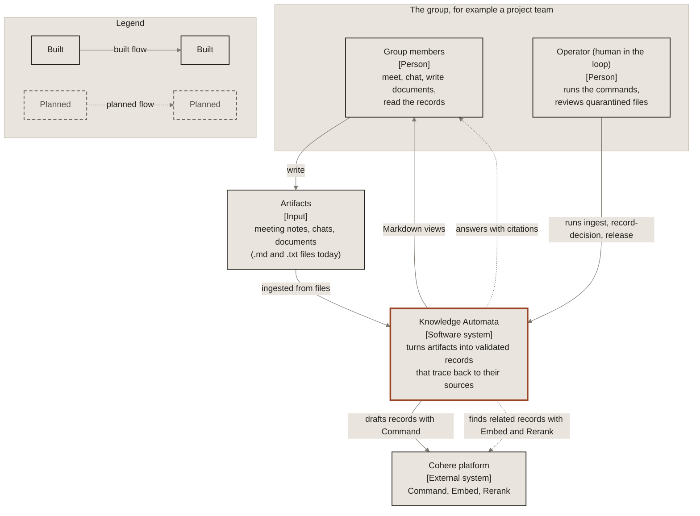
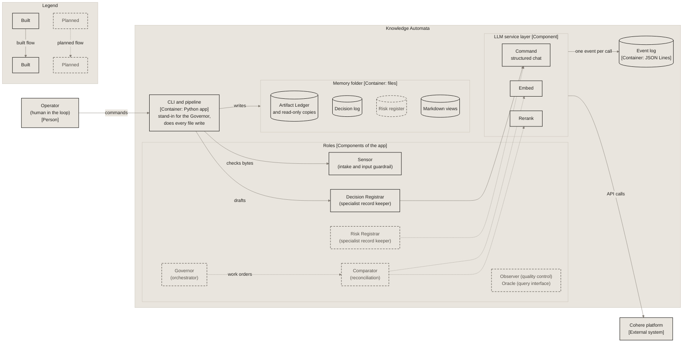
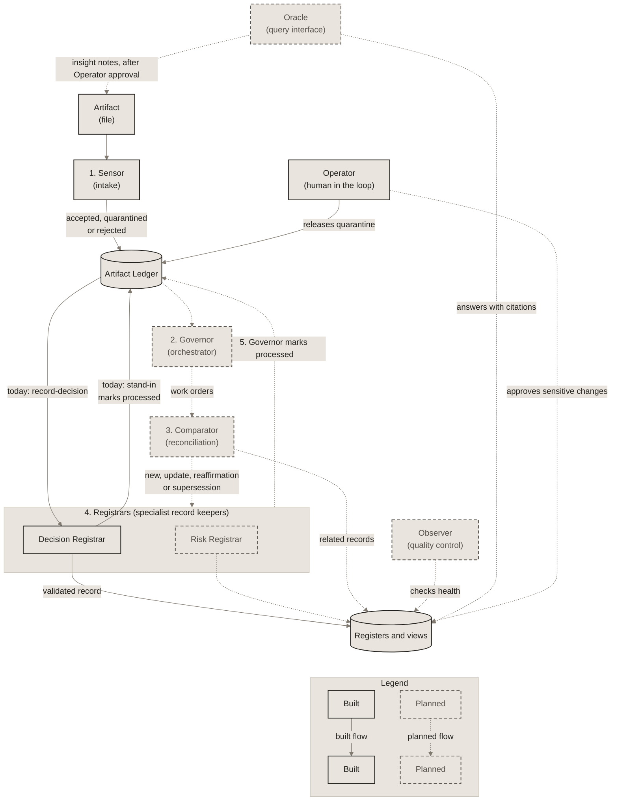

# Architecture

*Draft, v0.1*

## Overview

Knowledge Automata is designed as a closed-loop control system for the knowledge of any decision-making group: it senses inputs, decides what to do, compares against current state, acts, and monitors the result, with a human operator overseeing it.

The diagrams in [diagrams/](diagrams/) are the source for this page, the README and the [guide](https://miguelmog10.github.io/knowledge-automata/guide/).

### System context

<!-- diagram: system-context. Copy of docs/diagrams/01-system-context.md; edit that file first. -->

<!-- /diagram -->

Solid boxes and arrows are built on `main` today; dashed boxes and dotted arrows are planned. See the [interactive version in the guide](https://miguelmog10.github.io/knowledge-automata/guide/#context).

### Containers

<!-- diagram: containers. Copy of docs/diagrams/02-containers.md; edit that file first. -->

<!-- /diagram -->

Solid boxes and arrows are built on `main` today; dashed boxes and dotted arrows are planned. See the [interactive version in the guide](https://miguelmog10.github.io/knowledge-automata/guide/#containers).

## Design principle

**Use the LLM only where judgement is needed; use deterministic code for everything that can be checked.**

Understanding an artifact, drafting a record and judging how it relates to existing records need a model. Hashing, validation, ID assignment, the evidence quote check, write rules, Markdown views and cost tracking do not: code does them, which is cheaper, faster, repeatable and testable. Every LLM output is treated as a proposal that code checks before it is used.

## Roles

| Name | Plain role | Responsibility | v0.1 |
|---|---|---|---|
| Sensor | Intake and input guardrail | Validates, hashes, normalizes and logs incoming artifacts in the Artifact Ledger; quarantines invalid or suspicious input | Yes (deterministic checks only) |
| Governor | Orchestrator and router | Analyzes an accepted artifact and issues work orders to the relevant Registrars; marks artifacts processed or failed | Yes |
| Comparator | Reconciliation | Compares each validated draft with related active records (Embed, then Rerank) and classifies it as new, update, reaffirmation or supersession; code checks the proposal before anything is written | Yes (built for the decision log) |
| Registrars | Specialist record keepers | One per register; drafts structured records that code validates, assigns IDs to and stores | Decision and Risk |
| Observer | Quality control | Periodic health and cross-register consistency checks | Later |
| Oracle | Query interface | Answers questions over the registers with citations to records and source artifacts | Stretch |
| Operator | Human in the loop | Approves sensitive changes, reviews quarantine, overrides the system. A role, not an agent | Later (workflow) |

## Data flow for one artifact

1. **Sensor (intake):** the artifact arrives. The Sensor checks it, hashes it and records it in the Artifact Ledger as accepted, quarantined or rejected. If accepted, it normalizes the text and adds metadata. Its checks are deterministic (format, empty, encoding, size, delimiter), and accepted and quarantined artifacts are kept as read-only copies ([ADR-0015](decisions/0015-artifact-ledger-storage-and-sensor-checks.md)).
2. **Governor (orchestrator):** reads the artifact, identifies its content (for example two decisions and one risk) and sends work orders to the Decision and Risk Registrars.
3. **Registrars (specialist record keepers):** for each work order, draft records as structured data, with evidence quotes from the artifact. Code checks the evidence quotes and validates the draft against the schema. A rejected draft affects only that record. Independent Registrars can run in parallel. All Registrars share one drafting loop: an invalid draft gets one retry with its validation errors, and if the retry fails too, the record is rejected and nothing is written ([ADR-0014](decisions/0014-registrar-drafting-loop.md)).
4. **Comparator (reconciliation):** for each checked draft, retrieves related active records in the same register (Embed ranks them, Rerank reorders the closest) and proposes a classification (new, update, reaffirmation or supersession) and a target record. Code checks the proposal, with one retry as in the drafting loop, then assigns the ID of any new record and applies the write rule. This order is deliberate: the Comparator only judges content that code has already grounded in the artifact ([ADR-0017](decisions/0017-comparator-reconciliation.md)).
5. **Governor:** marks the artifact as processed in the Ledger, listing the records it produced.

The Sensor and the Artifact Ledger run since handoff 005: `knowledge-automata ingest` is step 1. `knowledge-automata record-decision` runs steps 3 to 5 for the decision log on an accepted artifact, with a pipeline stand-in for the Governor that skips step 2 and sets `processed` and `failed`. An artifact whose run recorded nothing (its draft or comparison was rejected, or a provider error stopped it) can be run again. The Sensor decides from bytes alone; the stand-in writes the artifact copies, records and Ledger entries, because agents never touch storage. A quarantined artifact waits for the Operator's `knowledge-automata release`.

Around this loop: the Observer (quality control) checks register health, the Oracle (query interface) answers questions from stored records, and the Operator (human in the loop) approves sensitive changes.

<!-- diagram: closed-loop. Copy of docs/diagrams/03-closed-loop.md; edit that file first. -->

<!-- /diagram -->

Solid boxes and arrows are built on `main` today; dashed boxes and dotted arrows are planned. See the [interactive version in the guide](https://miguelmog10.github.io/knowledge-automata/guide/#loop).

The [ART-0001 to DEC-0001 sequence diagram](diagrams/04-art-0001-to-dec-0001.md) follows the real run that produced the sample decision record, including the one retry.

## Write rules

Raw artifacts are read-only. Every record links back to its source artifacts, and every Ledger entry links forward to the records it produced. The record model and write rules are set out in [ADR-0011](decisions/0011-record-model-and-write-rules.md).

- **Envelope and content.** Every record has an envelope owned by code (`schemas/core/record.v1.json`: ID, register, schema version, status, revision, timestamps, sources, relations and history) and a `content` part drafted by a Registrar and validated against its register's content schema. LLM output only ever lands in `content`.
- **Evidence check.** A Registrar returns its content with evidence: quotes copied word for word from the artifact. Code normalizes the text and checks that every quote appears in the artifact. A failed quote rejects that record only, and the rejection is logged.
- **Checked links.** The Comparator's classification and target are LLM judgements. Code checks that the target was a candidate, belongs to the same register and is active, and that the transition is allowed, before it writes relations and history.

| Classification | Decision log | Risk register |
|---|---|---|
| new | Create the record. | Create the record. |
| update | Fills only fields that are empty in the existing record and adds the verified quotes as new sources. Values for fields that are already filled are ignored and the differences reported (a real change of substance is a supersession). | Fields present in the draft overwrite existing values; fields absent from the draft are kept (the LLM cannot remove a field in v0.1). |
| reaffirmation | Adds the verified quotes as new sources and a history entry. Draft content is ignored. | Same as decision log. |
| supersession | Creates a new record with `relations.supersedes`; the old record becomes `superseded` with `relations.superseded_by` and a `superseded` history entry. A reversal is a new decision that supersedes the old one. | Not allowed in v0.1 (the Comparator should return update). |

Every change increments `revision` and appends a history entry. Only `active` records can be the target of update, reaffirmation or supersession.

An existing record changes only through a revision ([ADR-0017](decisions/0017-comparator-reconciliation.md)): the store replaces the file only if it still holds the revision the change was based on (no lost update), the revision goes up by one, and earlier history entries and sources stay unchanged. A supersession changes two files with no transaction, so code writes the new record (with `relations.supersedes`) before it marks the old one superseded. An interruption between the two writes leaves a new record whose target is still active: `record-decision` and `views` detect it and stop before any call, and in v0.1 it is repaired by hand.

## Storage and views

Records live in a **memory folder**: the stored institutional memory of one group ([ADR-0013](decisions/0013-record-storage-json-files.md)). The folder is a parameter of the CLI: the default, `runtime/memory`, is git-ignored, and the sample project in `examples/sample-project` is a committed one.

```
<memory>/
  artifacts/ART-0001-board-notes.md  copies of accepted and quarantined artifacts (read-only)
  ledger/ART-0001.json               one Artifact Ledger entry per artifact
  registers/decision-log/DEC-0001.json
  views/decision-log.md              index (generated)
  views/decision-log/DEC-0001.md     one page per decision (generated)
```

- **The Ledger tracks every artifact.** Each entry is one JSON file in the same deterministic format as records, validated before every write, with the current status and an append-only history of transitions. Only a valid status change may overwrite it ([ADR-0015](decisions/0015-artifact-ledger-storage-and-sensor-checks.md)). Writes go record, views, then Ledger, so an interrupted run leaves the Ledger behind the records, and the next run detects it.
- **JSON records are the source of truth.** Each record is one file, validated (envelope and content) before it is written, written to a temporary file and moved into place. A new record never overwrites an existing file; records can be revised (see Write rules) but are never deleted. Files are deterministic (UTF-8, LF line endings, two-space indentation, fixed key order), so diffs show only real changes.
- **Views are generated.** Code renders the Markdown views from the records with standard relative links (index to pages, pages to their source artifacts, supersession both ways), so the registers browse like a wiki on GitHub. Each decision page groups its quotes under one heading per source artifact, and its history table has a Details column naming the fields an update filled and the decision a supersession replaced or was replaced by. Nobody edits them by hand: `knowledge-automata views` regenerates them, and CI runs `knowledge-automata views --check` on the sample project, which fails when the committed views differ from the generator's output.

## Domains and applications

The core (Sensor, Governor, Comparator, Observer, Oracle, Operator and the Artifact Ledger) is domain-neutral. A domain is a set of Registrars and their schemas. v0.1 ships the project-management domain, with registers aligned to PMI's PMBOK Guide (ADR-0007, ADR-0009). Possible future domains include an association (charter, motions, member decisions) or a research group (hypotheses, experiments, findings).

## LLM service layer

All model calls go through `knowledge_automata.llm` (ADR-0003, [ADR-0012](decisions/0012-llm-service-layer-observation-and-cost.md)). It offers three provider-neutral interfaces: structured chat (`chat_json`, which returns a parsed JSON object), embeddings and reranking. Each provider has one adapter, and only the Cohere adapter imports the Cohere SDK. Callers get a ready, observed implementation from `build_llm` and never assemble the pieces themselves; tests use a deterministic fake adapter and never touch the network. Following the design principle, the service layer only parses the model's JSON: callers validate it against their record schemas and decide what to do when it fails.

## Patterns and terminology

| Concept in this project | Established term |
|---|---|
| Overall system | Multi-agent system, orchestrator-workers pattern |
| Governor | Orchestrator, routing |
| Registrars working simultaneously | Parallelization |
| Comparator | Retrieve-then-rerank, retrieval-augmented generation (RAG) for entity resolution |
| Oracle | Retrieval-augmented generation (RAG) with citations |
| Schema validation with retry | Evaluator-optimizer loop |
| Evidence quote check | Grounding check (attribution to source text) |
| Sensor | Input guardrails |
| Operator | Human-in-the-loop |
| Shared registers | Blackboard architecture |
| The full closed loop | MAPE-K loop (Monitor, Analyse, Plan, Execute over shared Knowledge), from IBM's autonomic computing work |
| Observation wrapper (`ObservedLLM`) | Decorator pattern |
| Fake adapter (`FakeLLM`) | Test double (fake) |

## Security: defence in depth

The Sensor is the first line of defence, not the only one. Artifact text is always treated as data, schema validation blocks malformed writes, and the Operator approves sensitive changes. Together these protect the institutional memory from contamination (memory poisoning). Prompt-injection and relevance checks in the Sensor are planned (see `dev/backlog.md`). These guardrails are also relevant evidence for future cybersecurity compliance work such as the EU Cyber Resilience Act.

Supply-chain security (dependency auditing, pinned CI actions and an SBOM per release) complements this runtime defence in depth (ADR-0010).

## Observability

Every LLM call through the service layer writes one event to a JSON Lines log (by default `runtime/logs/llm-events.jsonl`, git-ignored). Events hold metadata only: the event schema version, time, a run ID that groups the calls of one run (one smoke check, later one pipeline run), the provider's request ID, provider, model, operation, the calling agent, the artifact ID and prompt version, status and error type, latency, and every unit the provider reports: billed units (input and output tokens, search units) and, when reported separately, raw token counts. Since event schema 1.1 they also carry the provider's reason the model stopped (`finish_reason`, for example `MAX_TOKENS`) and, for failed calls, the project exception's message, whose text never holds keys, prompts or artifact text. They never hold prompts, artifact text, model output or keys, so the log is safe to keep and share and cannot become an unvalidated second copy of the institutional memory. Each event is validated against `schemas/core/llm-event.v1.json` before it is written; failed calls are logged too, with the units they were billed for. The log is append-only and survives across runs: lines are only ever added, never rewritten or rotated, and if the file is deleted the next call starts a new one.

Cost is estimated from billed units and a dated price table (`prices.toml`, inside the package) copied from the provider's official pricing page. A model without a published price is left out of the table, and its events carry no cost rather than a guess; the units are always recorded, so cost can be computed later. Because every event carries the artifact ID, and the Ledger links artifacts to records, cost per artifact and per record can be derived. The event format should stay compatible with a later move to a standard such as OpenTelemetry. See [ADR-0012](decisions/0012-llm-service-layer-observation-and-cost.md).

## Vision: an architecture, not just an implementation

Each role is defined by a contract: its inputs, its outputs, the schemas it must follow and what it may write. This Python package is the **reference implementation**. Anything that honours a role's contract could fill that role, for example a GitHub Copilot agent, an Atlassian Rovo agent or a CI pipeline step, connected to systems such as Jira, Confluence or Microsoft Teams.
