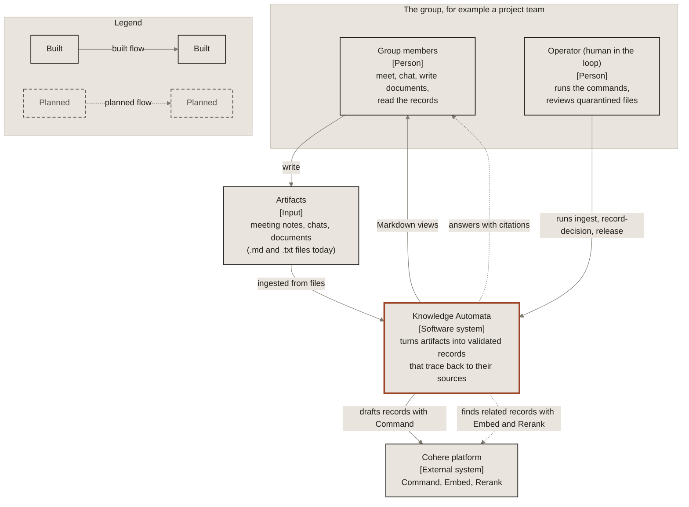

# System context

Who and what Knowledge Automata works with (C4 level 1). A group writes artifacts; its Operator (human in the loop) runs Knowledge Automata, which drafts records with Cohere Command and publishes Markdown views.

Solid boxes and arrows are built on `main` today. Dashed boxes and dotted arrows are planned.

See the [interactive version in the guide](https://miguelmog10.github.io/knowledge-automata/guide/#context).

*Source of truth for this diagram. Copies: docs/architecture.md (Overview). Edit this file first, then update the copies between their `diagram` markers.*
