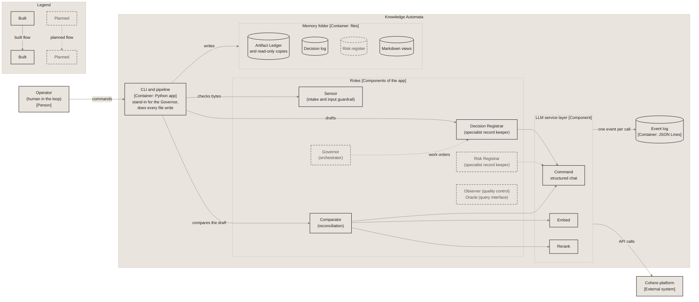

# Containers

What runs inside Knowledge Automata (C4 level 2): one Python command-line app and two file stores. The roles are components of the app. A pipeline stand-in for the Governor (orchestrator) does every file write, because agents never import storage.

Solid boxes and arrows are built on `main` today. Dashed boxes and dotted arrows are planned.

See the [interactive version in the guide](https://miguelmog10.github.io/knowledge-automata/guide/#containers).

*Source of truth for this diagram. Copies: docs/architecture.md (Overview). Edit this file first, then update the copies between their `diagram` markers.*
