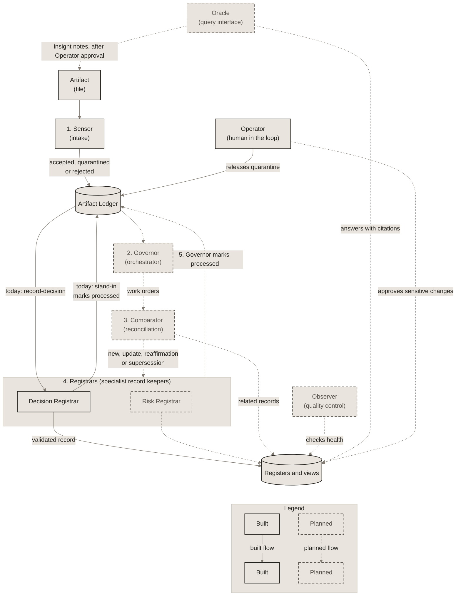

# The closed loop for one artifact

Steps 1 to 5 of "How it works" in the README. Today `record-decision` skips steps 2 and 3, and a pipeline stand-in marks the artifact processed. Dotted lines back toward the start are planned feedback loops.

Solid boxes and arrows are built on `main` today. Dashed boxes and dotted arrows are planned.

See the [interactive version in the guide](https://miguelmog10.github.io/knowledge-automata/guide/#loop).

*Source of truth for this diagram. Copies: README.md (How it works), docs/architecture.md (Data flow for one artifact). Edit this file first, then update the copies between their `diagram` markers.*
