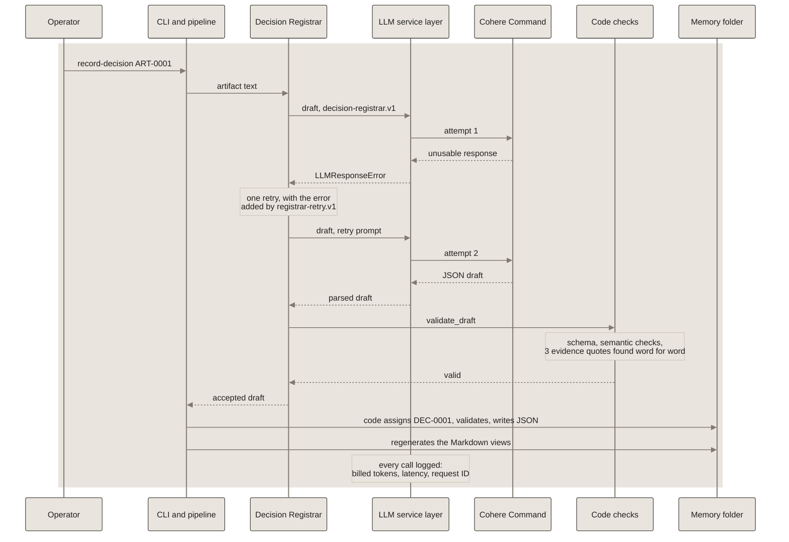

# How ART-0001 became DEC-0001

The real run of 2026-10-26 that produced the sample record. Attempt 1 returned an unusable response, the one retry was accepted, and code checked the draft before assigning `DEC-0001`. The Artifact Ledger entry for `ART-0001` was backfilled later (handoff 005).

Every step in this diagram is built and ran for real.

See the [interactive version in the guide](https://miguelmog10.github.io/knowledge-automata/guide/#walkthrough).

*Source of truth for this diagram. Copies: none (linked from docs/architecture.md). Edit this file first, then update the copies between their `diagram` markers.*
